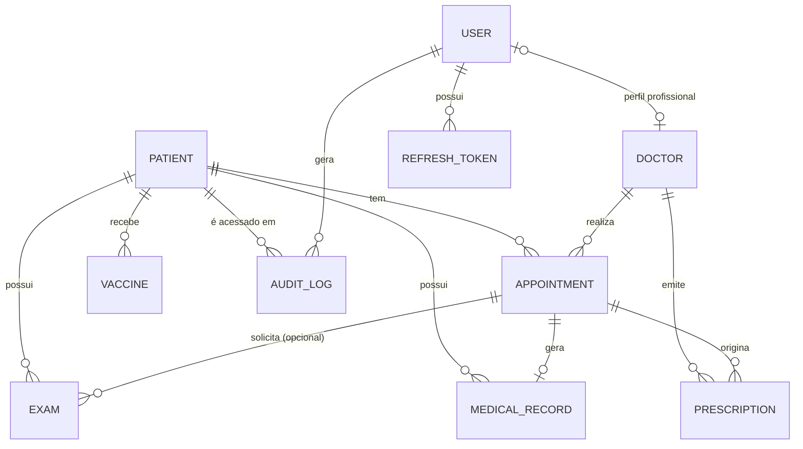

# SUS Connect: Arquitetura

> Dia 2 do Build to Learn. Este documento é o projeto no papel: **nenhum código** foi escrito para ele.
> Tudo aqui pode (e deve) ser questionado e ajustado antes do Dia 3.

## 1. Visão geral

SUS Connect é uma versão **educacional** do conceito de Prontuário Único do SUS: um cadastro único de paciente com histórico clínico centralizado e todo acesso auditado.

**Escopo do MVP:** autenticação e controle de acesso por papéis (RBAC), cadastro de pacientes e profissionais, atendimentos, prontuário (registro clínico), exames anexados, vacinas, prescrições e auditoria.

**Fora do escopo (por enquanto):** integração real com SUS/e-SUS/RNDS, assinatura digital, agendamento com disponibilidade, multi-unidade de saúde, faturamento, login gov.br, MFA, recuperação de senha por e-mail, portal do paciente (planejado como Fase 2, seção 12).

## 2. Princípios

1. **Regras de negócio no centro.** O domínio não conhece FastAPI, SQLAlchemy nem Postgres.
2. **Dependências apontam para dentro** (Clean Architecture): `api → application → domain` e `infrastructure → application/domain`.
3. **Dados de saúde são sensíveis (LGPD).** Menor privilégio, auditoria de leitura e nada de dados reais em desenvolvimento.
4. **Nada de exclusão física** de dados clínicos: desativa-se, não se apaga.
5. **TDD:** o comportamento é descrito em teste antes de existir em código.
6. **Nenhuma rota é pública por acidente.** Tudo exige autenticação e permissão explícita (negar por padrão).
7. **API-first.** A API é o produto; o frontend é um cliente. Nenhuma regra de negócio ou de permissão vive só no frontend.

## 3. Bounded Contexts

Um bounded context é uma fronteira onde um termo tem **um significado único**. No MVP, tudo roda em um único serviço (monolito modular), mas já separado em contextos para poder crescer.

| Contexto | Responsabilidade | Entidades |
|---|---|---|
| **Acesso** (Identity & Access) | Quem pode entrar no sistema e o que pode fazer | User, RefreshToken |
| **Cadastro** (Registry) | Quem são pacientes e profissionais | Patient, Doctor |
| **Atendimento** (Care) | O que aconteceu em cada consulta | Appointment, MedicalRecord, Prescription |
| **Diagnóstico e Imunização** (Clinical Data) | Dados clínicos de apoio | Exam, Vaccine |
| **Auditoria** (Audit) | Quem acessou o quê e quando | AuditLog |

Exemplo da fronteira: "paciente" no contexto de Atendimento é só um `patient_id` (referência); os dados cadastrais completos vivem no contexto de Cadastro. Do mesmo modo, `User` (quem acessa o sistema) é diferente de `Doctor` (profissional de saúde): um médico tem um usuário, mas nem todo usuário é médico.

## 4. Entidades

Convenção: nomes de código em inglês, textos de domínio e interface em português.

### Patient (paciente)
| Campo | Tipo | Regra |
|---|---|---|
| id | UUID | gerado pelo sistema |
| full_name | string | obrigatório |
| cpf | string(11) | obrigatório, único, dígitos verificadores válidos |
| cns | string(15) | opcional (Cartão Nacional de Saúde), 15 dígitos |
| birth_date | date | não pode ser futura |
| sex | enum | `F`, `M`, `OTHER` |
| phone, email | string | opcionais |
| address | value object | logradouro, número, bairro, cidade, UF, CEP |
| active | bool | `false` = desativado (soft delete) |
| created_at, updated_at | datetime | automáticos |

### Doctor (profissional de saúde)
| Campo | Tipo | Regra |
|---|---|---|
| id | UUID | |
| full_name | string | obrigatório |
| license_number + license_state | string | registro profissional (ex.: CRM/MS), par único |
| specialty | string | obrigatório |
| active | bool | |

> O nome `Doctor` vem do planejamento. Na prática pode ser qualquer profissional de saúde (enfermeiro, dentista). Mantemos `Doctor` no MVP por simplicidade.

### User (usuário do sistema)
| Campo | Tipo | Regra |
|---|---|---|
| id | UUID | |
| email | string | obrigatório, único, guardado em minúsculas |
| password_hash | string | Argon2id; nunca exposto pela API |
| full_name | string | obrigatório |
| role | enum | `ADMIN`, `DOCTOR`, `RECEPTIONIST` |
| doctor_id | UUID | obrigatório se `role = DOCTOR`; único; nulo nos demais papéis |
| active | bool | `false` = não consegue entrar (soft delete) |
| must_change_password | bool | `true` após criação ou redefinição por ADMIN |
| failed_login_attempts | int | zera no login com sucesso |
| locked_until | datetime | bloqueio temporário após 5 falhas |
| last_login_at | datetime | |
| created_at, updated_at | datetime | automáticos |

### RefreshToken
| Campo | Tipo | Regra |
|---|---|---|
| id | UUID | |
| user_id | UUID | |
| token_hash | string | SHA-256 do token; o token em si nunca é guardado |
| family_id | UUID | agrupa a cadeia de rotações |
| expires_at | datetime | 7 dias após a emissão |
| revoked_at | datetime | preenchido em logout, rotação ou revogação da família |
| replaced_by_id | UUID | token que o substituiu na rotação |
| created_at | datetime | |

### Appointment (atendimento)
| Campo | Tipo | Regra |
|---|---|---|
| id | UUID | |
| patient_id, doctor_id | UUID | paciente e médico precisam estar **ativos** |
| scheduled_at | datetime | obrigatório |
| status | enum | `SCHEDULED` → `COMPLETED` ou `CANCELLED` |
| reason | string | motivo / queixa principal |

### MedicalRecord (registro de prontuário)
**Decisão:** um `MedicalRecord` é o registro clínico gerado por **um** atendimento (1:1 com Appointment). O "prontuário completo" do paciente é a soma ordenada dos seus MedicalRecords.

| Campo | Tipo | Regra |
|---|---|---|
| id | UUID | |
| appointment_id | UUID | único |
| patient_id | UUID | redundante de propósito, para consulta rápida do histórico |
| anamnesis | text | história relatada |
| diagnosis | text | diagnóstico |
| cid10_code | string | opcional (ex.: `J06.9`) |
| conduct | text | conduta / orientações |
| **append-only** | | correções entram como **adendo** (`MedicalRecordAddendum`), nunca sobrescrevem |

### Exam (exame)
| Campo | Tipo | Regra |
|---|---|---|
| id | UUID | |
| patient_id | UUID | obrigatório |
| appointment_id | UUID | opcional |
| name | string | ex.: "Hemograma completo" |
| performed_at | date | |
| file_name, content_type, size_bytes, sha256 | | metadados do arquivo |
| storage_key | string | onde o arquivo está (o arquivo **não** fica no banco) |

Arquivos aceitos: PDF, PNG, JPG. Máximo de 10 MB.

### Prescription (prescrição)
| Campo | Tipo | Regra |
|---|---|---|
| id | UUID | |
| appointment_id | UUID | obrigatório |
| doctor_id | UUID | precisa ser o médico do atendimento |
| patient_id | UUID | |
| items | lista | cada item: `medication`, `dosage`, `frequency`, `duration_days`, `notes` |
| issued_at | datetime | |

### Vaccine (vacina aplicada)
| Campo | Tipo | Regra |
|---|---|---|
| id | UUID | |
| patient_id | UUID | |
| vaccine_name | string | ex.: "Influenza" |
| dose | string | ex.: "1ª dose", "reforço" |
| lot_number | string | |
| applied_at | date | não pode ser futura |
| applied_by | UUID | opcional (Doctor) |

### AuditLog (auditoria)
| Campo | Tipo | Regra |
|---|---|---|
| id | UUID | |
| actor_id | UUID | **quem** acessou (`User.id` vindo do token; nulo só em `LOGIN_FAILED` com e-mail inexistente) |
| actor_role | enum | papel do ator no momento do acesso |
| action | enum | `READ`, `CREATE`, `UPDATE`, `DEACTIVATE`, `LOGIN_SUCCESS`, `LOGIN_FAILED`, `LOGOUT`, `ACCESS_DENIED` |
| resource_type | string | **o que**: `Patient`, `Exam`... |
| resource_id | UUID | |
| patient_id | UUID | para responder "quem viu os dados deste paciente?" (nulo em eventos de autenticação) |
| occurred_at | datetime | **quando** |
| ip_address | string | |
| **append-only** | | nunca atualizado nem apagado |

## 5. Relacionamentos



## 6. Casos de uso

Um caso de uso é **uma coisa que o sistema faz** para um ator. Cada um vira uma classe/função na camada `application`.

| # | Caso de uso | Contexto | Regras principais |
|---|---|---|---|
| UC01 | RegisterPatient | Cadastro | CPF válido e único |
| UC02 | UpdatePatient | Cadastro | CPF não pode ser alterado; paciente deve estar ativo |
| UC03 | GetPatient | Cadastro | gera AuditLog `READ` |
| UC04 | SearchPatients | Cadastro | busca por nome ou CPF; gera AuditLog `READ` |
| UC05 | DeactivatePatient | Cadastro | soft delete; mantém todo o histórico |
| UC06 | RegisterDoctor | Cadastro | registro profissional único |
| UC07 | ScheduleAppointment | Atendimento | paciente e médico ativos |
| UC08 | UpdateAppointment | Atendimento | só enquanto `SCHEDULED` |
| UC09 | CompleteAppointment | Atendimento | exige MedicalRecord |
| UC10 | CancelAppointment | Atendimento | não cancela `COMPLETED` |
| UC11 | RecordMedicalRecord | Atendimento | 1 por atendimento; append-only |
| UC12 | IssuePrescription | Atendimento | só o médico do atendimento |
| UC13 | AttachExam | Diagnóstico | validação de tipo, tamanho e hash |
| UC14 | GetExam | Diagnóstico | gera AuditLog `READ` |
| UC15 | RegisterVaccine | Diagnóstico | data não futura |
| UC16 | GetPatientHistory | Atendimento | linha do tempo unificada; gera AuditLog `READ` |
| UC17 | ListAuditLogs | Auditoria | somente ADMIN; filtro por paciente/ator/período |
| UC18 | Login | Acesso | e-mail + senha; bloqueio após 5 falhas; erro genérico |
| UC19 | RefreshToken | Acesso | rotação; reuso de token antigo revoga a família |
| UC20 | Logout | Acesso | revoga o refresh token |
| UC21 | GetCurrentUser | Acesso | retorna o usuário do token (`GET /auth/me`) |
| UC22 | CreateUser | Acesso | somente ADMIN; `DOCTOR` exige vínculo com Doctor |
| UC23 | DeactivateUser | Acesso | somente ADMIN; revoga os refresh tokens dele |
| UC24 | ChangePassword | Acesso | exige a senha atual; aplica a política de senha |
| UC25 | ResetUserPassword | Acesso | somente ADMIN; senha temporária + `must_change_password` |
| UC26 | ReactivatePatient | Cadastro | desfaz a desativação; o CPF continua reservado enquanto o paciente estiver desativado |

> Todo caso de uso, exceto UC18 e UC19, exige usuário autenticado e a permissão correspondente da seção 7.

## 7. Autenticação e autorização

**Autenticar** = provar quem você é. **Autorizar** = decidir o que você pode fazer. As duas partes entram no MVP desde o início, para que auditoria, regras de negócio e frontend já nasçam sabendo "quem é o ator".

### 7.1 Fluxo de autenticação

1. `POST /auth/login` com e-mail e senha.
2. A API devolve um **access token** (JWT, vida curta de 15 min) e um **refresh token** (opaco, 7 dias).
3. Cada requisição envia `Authorization: Bearer <access token>`.
4. Quando o access token expira, `POST /auth/refresh` troca o refresh token por um par novo.
5. `POST /auth/logout` revoga o refresh token.

**Access token (JWT):** claims `sub` (user id), `role`, `iat`, `exp`, `jti`. Assinatura HS256 com segredo vindo de variável de ambiente. O token **não** carrega dados clínicos nem pessoais além do id e do papel.

**Refresh token:** string aleatória de 256 bits, guardada no banco **apenas como hash SHA-256**. Tem **rotação**: cada uso invalida o token anterior e emite outro da mesma `family_id`. Se um token **já usado** for apresentado de novo (sinal de roubo), toda a família é revogada.

### 7.2 Senhas e proteção de conta

- Hash com **Argon2id**. Nunca armazenar, logar ou retornar a senha ou o hash.
- Política: mínimo de 10 caracteres e diferente do e-mail.
- **5 falhas seguidas** bloqueiam a conta por 15 minutos (`locked_until`).
- Erro de login sempre genérico ("credenciais inválidas"), sem revelar se o e-mail existe.
- **Não há autocadastro.** Só `ADMIN` cria usuários. Redefinição de senha é feita por `ADMIN` (senha temporária + `must_change_password`).
- O primeiro `ADMIN` nasce de um comando de seed (`python -m app.cli create-admin`, usando `FIRST_ADMIN_EMAIL` e `FIRST_ADMIN_PASSWORD`) e é obrigado a trocar a senha no primeiro acesso.

### 7.3 Papéis (RBAC)

| Papel | Quem é | Princípio |
|---|---|---|
| `ADMIN` | Administrador do sistema | Gerencia usuários e auditoria. **Não acessa dados clínicos** (menor privilégio) |
| `DOCTOR` | Profissional de saúde | Atua sobre o cuidado do paciente. Vinculado a um registro `Doctor` |
| `RECEPTIONIST` | Recepção / administrativo | Cadastro e agenda. **Não vê conteúdo clínico** |

### 7.4 Matriz de permissões

| Ação | ADMIN | DOCTOR | RECEPTIONIST |
|---|:-:|:-:|:-:|
| Criar, editar e desativar usuários e profissionais (Doctor) | ✅ | ❌ | ❌ |
| Listar e ver profissionais (Doctor) | ✅ | ✅ | ✅ |
| Consultar AuditLog | ✅ | ❌ | ❌ |
| Cadastrar e atualizar paciente | ❌ | ✅ | ✅ |
| Desativar e reativar paciente | ❌ | ❌ | ✅ |
| Buscar e ver dados cadastrais do paciente | ❌ | ✅ | ✅ |
| Agendar, atualizar e cancelar atendimento | ❌ | ✅ | ✅ |
| Registrar prontuário, concluir atendimento, prescrever | ❌ | ✅ ¹ | ❌ |
| Ver prontuário, histórico e prescrições | ❌ | ✅ | ❌ |
| Anexar exame | ❌ | ✅ | ✅ |
| Ver exame | ❌ | ✅ | ❌ |
| Registrar vacina | ❌ | ✅ | ❌ |
| Ver vacinas | ❌ | ✅ | ❌ |

¹ Apenas nos **próprios** atendimentos (`appointment.doctor_id == user.doctor_id`).

**Regra geral: negar por padrão.** Toda rota declara explicitamente a permissão exigida; uma rota sem declaração é considerada um bug.

### 7.5 Auditoria de segurança

Além dos acessos a dados de paciente, o AuditLog registra `LOGIN_SUCCESS`, `LOGIN_FAILED`, `LOGOUT` e `ACCESS_DENIED` (tentativa sem permissão). O `actor_id` vem **sempre do token validado**, nunca de header ou corpo enviado pelo cliente.

### 7.6 Frontend (padrão BFF)

O Next.js atua como *backend for frontend*:
- O login passa por um route handler do Next, que chama a API e guarda os tokens em **cookies `httpOnly`**, `SameSite=Lax` e `Secure` em produção.
- O JavaScript do navegador **nunca** lê o token (reduz o estrago de um ataque XSS). Proibido `localStorage`/`sessionStorage` para tokens.
- O `middleware` do Next bloqueia rotas protegidas e redireciona para `/login`.
- Mutações verificam o cabeçalho `Origin` (defesa extra contra CSRF).
- O CORS da API fica restrito, pois o navegador fala com o Next, não direto com a API.

## 8. Camadas e estrutura de pastas

```
apps/api/app/
├── domain/            # entidades, value objects, regras, interfaces (ports)
│   ├── user.py
│   ├── patient.py
│   ├── ...
│   └── repositories.py      # interfaces: PatientRepository, etc.
├── application/       # casos de uso (orquestram domínio + ports)
│   └── use_cases/
├── infrastructure/    # implementações concretas
│   ├── database/            # SQLAlchemy models, repositórios, Alembic
│   ├── storage/             # FileStorage (disco local no MVP)
│   └── security/            # hash de senha (Argon2id) e emissão/validação de JWT
└── api/               # FastAPI: routers, schemas (Pydantic), dependências
```

**Regra de dependência:** `domain` não importa nada de fora. `application` importa só `domain`. `infrastructure` e `api` importam `application`/`domain`.

> **Estratégia de aprendizado:** no Dia 4 vamos fazer os testes passarem com o **mínimo** de estrutura. No Dia 5 refatoramos para estas camadas com os mesmos testes verdes. Esta seção é o alvo do Dia 5.

## 9. API (planejada)

| Método | Rota | Caso de uso |
|---|---|---|
| POST | /patients | UC01 |
| GET | /patients/{id} | UC03 |
| GET | /patients?q= | UC04 |
| PUT | /patients/{id} | UC02 |
| DELETE | /patients/{id} | UC05 (desativa, não apaga) |
| POST | /appointments | UC07 |
| GET | /appointments | listagem com filtros |
| PUT | /appointments/{id} | UC08 |
| POST | /exams | UC13 (upload) |
| GET | /exams/{id} | UC14 |
| GET | /patients/{id}/history | UC16 |
| POST | /auth/login | UC18 (pública) |
| POST | /auth/refresh | UC19 (pública) |
| POST | /auth/logout | UC20 |
| GET | /auth/me | UC21 |
| POST | /auth/change-password | UC24 |
| POST | /users | UC22 (ADMIN) |
| POST | /users/{id}/deactivate | UC23 (ADMIN) |
| POST | /users/{id}/reset-password | UC25 (ADMIN) |
| GET | /audit-logs | UC17 (ADMIN) |
| POST | /doctors | UC06 (ADMIN) |
| GET | /doctors | listagem paginada |
| GET | /doctors/{id} | detalhe |
| DELETE | /doctors/{id} | desativa o profissional (ADMIN) |
| GET | /appointments/{id} | detalhe |
| POST | /appointments/{id}/complete | UC09 |
| POST | /appointments/{id}/cancel | UC10 |
| POST | /appointments/{id}/medical-record | UC11 |
| GET | /appointments/{id}/medical-record | consulta do registro e dos adendos |
| POST | /medical-records/{id}/addenda | adendo ao registro (UC11) |
| POST | /appointments/{id}/prescriptions | UC12 |
| GET | /appointments/{id}/prescriptions | listagem |
| GET | /exams/{id}/file | download do arquivo (UC14) |
| GET | /patients/{id}/exams | exames do paciente |
| POST | /patients/{id}/vaccines | UC15 |
| GET | /patients/{id}/vaccines | vacinas do paciente |
| POST | /patients/{id}/reactivate | UC26 |

> **Prefixo e versionamento:** todas as rotas de negócio ficam sob `/api/v1` (ex.: `/api/v1/patients`). A tabela acima mostra as rotas sem o prefixo por brevidade. Os endpoints `/health*` ficam fora do prefixo.
>
> Todas as rotas exigem `Authorization: Bearer`, exceto `/api/v1/auth/login`, `/api/v1/auth/refresh` e `/health*`.

### Convenções da API

Estas convenções são o **contrato** que os testes do Dia 3 verificam.

| Situação | Status |
|---|---|
| Recurso criado | `201` |
| Desativação (`DELETE`) | `204` |
| Demais operações com sucesso | `200` |
| Sem token ou token inválido | `401` |
| Sem permissão para a ação | `403` |
| Recurso inexistente | `404` |
| Duplicidade (CPF, e-mail, registro profissional) ou regra de estado violada (editar atendimento concluído, paciente desativado) | `409` |
| Validação de entrada (CPF inválido, data futura, campo imutável, data sem fuso) | `422` |
| Arquivo de tipo não aceito | `415` |
| Arquivo acima de 10 MB | `413` |

- **Login:** e-mail inexistente, senha errada e conta bloqueada respondem **o mesmo** `401` com `{"detail": "Invalid credentials"}`.
- **Listagens** retornam `{"items": [...], "total": N, "limit": L, "offset": O}`. Padrão `limit=20`, máximo `100`. O dashboard do Dia 6 usa o `total` dessas listagens.
- **Erros** seguem o formato do FastAPI (`{"detail": ...}`), com mensagens em inglês. A tradução para português é feita no frontend.
- **Datas e horas** em ISO 8601, sempre em **UTC** com fuso explícito. Datetime sem fuso é rejeitado (`422`). A conversão para o fuso local acontece só na exibição.
- **Respostas nunca incluem** `password_hash`, `token_hash` nem `storage_key`.

### Escopo da API por dia

| Fase | Dia | Rotas |
|---|---|---|
| Núcleo | 3 e 4 | Autenticação (login, refresh, logout, me, change-password), `POST /users`, profissionais, pacientes (CRUD, busca e paginação), atendimentos (CRUD, concluir, cancelar), registro de prontuário e adendo, exames |
| Auditoria e camadas | 5 | Gravação do AuditLog, `GET /audit-logs` e refatoração em camadas |
| Complementos | 6 (antes do frontend) | Vacinas, prescrições, histórico do paciente, reativar paciente, desativar usuário e redefinir senha. Também com TDD |

> **Cronograma da auditoria:** a gravação do AuditLog entra no Dia 5, com teste primeiro. Os testes dos Dias 3 e 4 não exigem auditoria; as regras da seção 7.5 valem para o MVP completo.

## 10. Segurança e LGPD

- Dados de saúde são **dado pessoal sensível** (LGPD, art. 11).
- Em desenvolvimento, **somente dados fictícios**.
- Todo acesso a dado de paciente gera `AuditLog`, inclusive leituras.
- Segredos só via variáveis de ambiente; nunca no repositório.
- Arquivos de exame ficam fora do banco, com hash SHA-256 para integridade.
- Respostas de erro não vazam dados do paciente.
- Autenticação (JWT), RBAC, Argon2id e proteção contra força bruta: ver seção 7.
- Evolução futura: MFA, login gov.br, criptografia em repouso, retenção e anonimização.

## 11. Decisões de arquitetura (ADRs resumidos)

| # | Decisão | Motivo |
|---|---|---|
| ADR-01 | Monolito modular, não microsserviços | Menos complexidade; fronteiras já definidas |
| ADR-02 | UUID como identificador | Não expõe sequência nem volume de pacientes |
| ADR-03 | Soft delete em Patient e Doctor | Histórico clínico não pode ficar órfão |
| ADR-04 | MedicalRecord e AuditLog append-only | Integridade e rastreabilidade |
| ADR-05 | Arquivos fora do banco, atrás da interface `FileStorage` | Trocar disco por S3 depois sem mexer no domínio |
| ADR-06 | Clean Architecture aplicada na refatoração (Dia 5) | Aprender o "antes e depois" |
| ADR-07 | JWT de acesso curto (15 min) + refresh token opaco com rotação | Limita o dano de um token vazado e permite revogação |
| ADR-08 | Senhas com Argon2id | Algoritmo recomendado atualmente (OWASP), resistente a GPU |
| ADR-09 | Tokens em cookies `httpOnly` via Next.js (BFF) | JavaScript do navegador não consegue roubar o token |
| ADR-10 | RBAC com 3 papéis e deny-by-default | Simples de entender, testar e auditar |
| ADR-11 | `ADMIN` sem acesso a dados clínicos | Menor privilégio: quem administra não precisa ver prontuários |
| ADR-12 | API versionada em `/api/v1`; a API é o produto e o frontend é um cliente | Permite novos clientes (portal do paciente, app) sem quebrar os existentes |

## 12. Decisões em aberto

1. **Acesso ao paciente por vínculo.** No MVP, qualquer `DOCTOR` autenticado pode consultar qualquer paciente (visão "única"), compensado por auditoria completa. Evolução: restringir a profissionais com vínculo ou exigir justificativa registrada ("quebra de vidro").
2. **Perfis adicionais.** Enfermeiro, agente de saúde e paciente. Hoje existem só `ADMIN`, `DOCTOR` e `RECEPTIONIST`.
3. **Segredo do JWT.** HS256 com segredo em variável de ambiente no MVP; em produção, avaliar RS256 com rotação de chaves.
4. **Armazenamento dos exames.** Volume Docker local no MVP; S3 compatível no deploy.

**Resolvidas:** autenticação e papéis (seção 7 e ADR-07 a ADR-11).

### Fase 2: portal do paciente e novos clientes (depois do deploy)

A API é o produto e o `apps/web` é o primeiro cliente (profissionais). Um segundo cliente (portal ou app do paciente, dashboard próprio) deve consumir a mesma API. O que fica para depois, sem exigir retrabalho:

| Item | O que é | Impacto no que já existe |
|---|---|---|
| Papel `PATIENT` + rotas `/me/...` | Paciente vê só os próprios dados, somente leitura | Novo valor no enum `role` e campo `patient_id` em `User`. O paciente é identificado **pelo token**, nunca por id na URL |
| Verificação de identidade | Confirmar que a pessoa é dona do CPF (gov.br) | Fluxo novo; nenhuma rota atual muda |
| Recuperação de senha | Redefinição por e-mail ou SMS | Fluxo novo; hoje o ADMIN redefine |
| Rate limiting | Limite de requisições por usuário e IP | Middleware novo |
| Resumo do dashboard | `GET /api/v1/dashboard/summary` (no MVP, o dashboard usa o `total` das listagens paginadas) | Rota nova |
| CORS configurável | Lista de origens permitidas por variável de ambiente | Troca em um único arquivo |
| Cliente de origem no AuditLog | Coluna `client` (ex.: `professional-web`) | Coluna nova |

**Já preparado desde o MVP:** prefixo `/api/v1` em todas as rotas (ADR-12) e paginação (`limit`/`offset`) em todas as listagens.

## 13. Estratégia de testes

| Tipo | Onde | Quando |
|---|---|---|
| **API (caixa-preta)**: foco principal | `apps/api/tests/`, via `TestClient` do FastAPI | Dia 3 em diante |
| **Unitários de domínio** (CPF, regras de estado) | `apps/api/tests/unit/` | Dia 5, durante a refatoração |
| **Ponta a ponta** (Playwright) | `tests/` na raiz | Dias 6 e 7 |

**Banco de testes:** o mesmo Postgres do Compose, mas em um banco separado, `<POSTGRES_DB>_test`. A criação do banco, o schema (Alembic) e a limpeza (`TRUNCATE`) entre testes são implementados no Dia 4, junto com os modelos.

**Fixtures** (em `conftest.py`): `client`, `admin`, `doctor`, `other_doctor`, `receptionist` (cada papel já vem logado, com `headers` prontos), `patient`, `scheduled_appointment` e `create_account`. Os usuários de teste são criados por `app.cli.create_user`, a mesma função do comando de seed do primeiro ADMIN. **Payloads válidos** vêm de `tests/factories.py`, que também gera CPFs válidos.

**O vermelho do Dia 3 precisa ser pelo motivo certo.** Vale como falha: rota inexistente (`404`) onde se esperava outro status, ou `ERROR` por fixture que depende de código do Dia 4 (`app.cli`). Não vale: erro de digitação, import quebrado no teste ou fixture mal escrita.

**Independência:** cada teste cria os próprios dados e não depende de ordem de execução.

**Rodar:** `docker compose exec api pytest`
